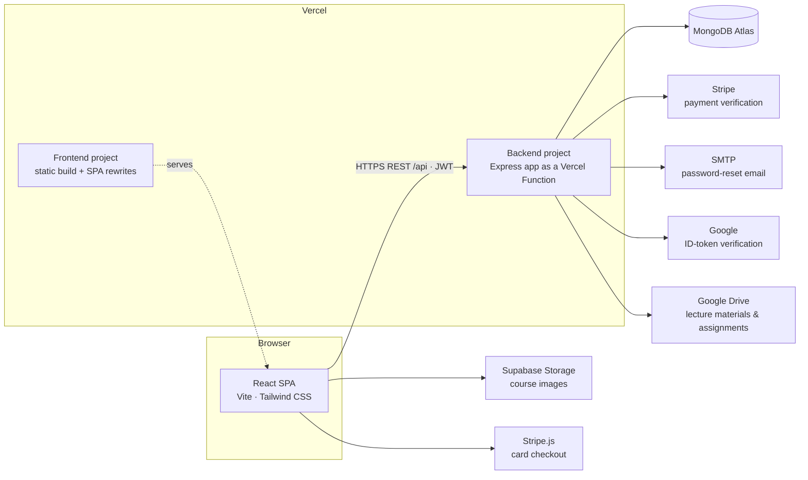

<div align="center">


# SRI-KO LMS

**A full-stack Learning Management System for the SRI-KO Foreign Language Training Center — Korean language courses, payments, progress and attendance tracking, an admin portal, and a built-in support assistant.**


</div>

---

## Table of Contents

- [Overview](#overview)
- [Key Features](#key-features)
- [Tech Stack](#tech-stack)
- [Architecture](#architecture)
- [Project Structure](#project-structure)
- [Getting Started (Local Development)](#getting-started-local-development)
- [Environment Variables](#environment-variables)
- [Deploying to Vercel](#deploying-to-vercel)
- [Attendance Module](#attendance-module)
- [Support Assistant (Chatbot)](#support-assistant-chatbot)
- [API Reference](#api-reference)
- [Security](#security)
- [Available Scripts](#available-scripts)
- [Troubleshooting](#troubleshooting)
- [Contributing](#contributing)
- [License](#license)

---

## Overview

SRI-KO LMS is the online learning platform of the **SRI-KO Foreign Language Training Center** in Colombo, Sri Lanka. It serves three audiences:

| Audience | What they get |
| --- | --- |
| **Visitors** | Course catalog, program information, a Join Us application form, and a 24/7 support assistant. |
| **Students** | Enrollment and secure card payments, learning progress, self-service attendance tracking, announcements, notifications, discussion forums, and a personal dashboard. |
| **Administrators** | A dedicated admin portal to manage users, courses, payments, announcements, notifications, forums, program applications, and to monitor attendance and analytics. |

The repository is a monorepo with two independently deployable applications:

- **`frontend/`** — React single-page application (Vite + Tailwind CSS).
- **`backend/`** — REST API (Node.js + Express + MongoDB/Mongoose), with optional real-time notifications over Socket.IO.

---

## Key Features

### Student portal

- **Accounts** — email/password registration and login, Sign in with Google, password reset with a 6-digit email code (valid 10 minutes).
- **Course catalog & enrollment** — browse published courses, view curricula, enroll in free courses instantly or pay securely by card (Stripe).
- **Course materials & assignments** — stream lecture videos, view PDFs and images, and submit assignment files with upload progress.
- **Events** — browse upcoming seminars, workshops and cultural events.
- **Learning dashboard** — enrolled courses, progress, certificates, recent activity and attendance rate.
- **Attendance tracking** — mark yourself present, late, excused or absent for any day on a calendar; see your rate, history and monthly overview.
- **Announcements & notifications** — targeted announcements and in-app notifications (real time via Socket.IO, or automatic polling).
- **Discussion forums** — ask questions and practise with other learners.
- **Profile & settings** — profile details, privacy and notification preferences, password change, and profile photos (automatically resized in the browser).
- **Help Center & support assistant** — instant answers drawn from live course and account data.

### Admin portal

- **Dashboard** — live totals (users, courses, revenue, completed courses), recent users and courses, Korean program applications, and a real-time activity feed (registrations, payments, attendance, applications).
- **User management** — create, edit, activate/deactivate, delete and change roles.
- **Course management** — create and edit courses and curricula, upload images, publish or unpublish, upload lecture materials (stored on Google Drive), and review and grade assignment submissions.
- **Events management** — create, edit, pin and activate events shown on the public Events page.
- **Attendance** — monitor attendance marked by students: rate and trends, status breakdown, per-course and per-student summaries, filters, drill-down, and CSV export. See [Attendance Module](#attendance-module).
- **Analytics & reports** — growth, revenue and engagement metrics with CSV/PDF export.
- **Payments** — payment history, statistics, status updates and manual payment recording.
- **Communication** — announcements and notifications (targeted to roles, users or courses).
- **Discussion forums** — moderation (pin, lock, activate) and forum management.
- **Korean program applications** — review and update Join Us submissions.
- **System settings** — site, contact and platform configuration.

---

## Tech Stack

| Layer | Technologies |
| --- | --- |
| **Frontend** | React 19, React Router 7, Vite 8, Tailwind CSS 4, Axios, Socket.IO client, Stripe.js, Supabase JS, `@react-oauth/google`, lucide-react, react-hot-toast |
| **Backend** | Node.js (≥ 22.12), Express 5, Mongoose 9, Socket.IO 4, JSON Web Tokens, bcryptjs, express-validator, Multer, Stripe, Nodemailer, google-auth-library |
| **Database** | MongoDB Atlas |
| **File storage** | Supabase Storage (course and announcement images), Google Drive (lecture materials and assignment submissions); profile photos are stored in MongoDB |
| **Hosting** | Vercel (two projects: static frontend + Express backend as a Vercel Function) |

---

## Architecture



**How requests flow**

1. The browser loads the static React build from the frontend project.
2. The SPA calls the REST API at `VITE_API_URL` (for example `https://sri-ko-backend.vercel.app/api`) with a JWT in the `Authorization: Bearer <token>` header.
3. The Express app (`backend/app.js`) checks the MongoDB connection, authenticates the user, enforces role and ownership rules, and responds with JSON.
4. **Real-time notifications:** when the backend runs as a long-running Node server (`npm run dev` / `npm start`), Socket.IO pushes new notifications instantly. On Vercel the app runs without Socket.IO and the frontend refreshes notifications every 60 seconds and whenever the tab regains focus.

---

## Project Structure

```text
app/
├── backend/
│   ├── app.js               # Express app (exported; used by Vercel and server.js)
│   ├── server.js            # Long-running server: HTTP listener + Socket.IO
│   ├── vercel.json          # Vercel project config (Express framework preset)
│   ├── config/              # Cached MongoDB connection, CORS allowlist
│   ├── middleware/          # JWT auth & roles, request validation, uploads
│   ├── models/              # Mongoose schemas (User, Course, Attendance, ...)
│   ├── routes/              # REST API routes, one file per module
│   ├── services/            # NotificationEngine, ChatbotEngine
│   ├── socket/              # Socket.IO manager (real-time notifications)
│   ├── utils/               # Attendance date helpers, regex escaping
│   └── env.example          # Backend environment template
├── frontend/
│   ├── index.html
│   ├── vercel.json          # SPA rewrites + long-term asset caching
│   ├── public/              # Static images and icons
│   ├── env.example          # Frontend environment template
│   └── src/
│       ├── admin/           # Admin portal (loaded on demand)
│       ├── components/      # Layout, support assistant widget, shared UI
│       ├── config/          # API URL resolution, Supabase client
│       ├── context/         # Auth, Socket.IO and notification providers
│       ├── pages/           # Public and student pages
│       ├── services/        # API clients (attendance, chat, courses, ...)
│       └── utils/           # Browser helpers (image resizing)
├── LICENSE
├── README.md
└── VERCEL_DEPLOYMENT.md     # Step-by-step Vercel deployment guide
```

---

## Getting Started (Local Development)

### Prerequisites

- **Node.js 22.12 or newer** (Node 24 LTS recommended) and npm
- A **MongoDB** database — a free [MongoDB Atlas](https://www.mongodb.com/atlas) cluster works well
- Optional, for the related features: a [Stripe](https://dashboard.stripe.com/test/apikeys) test account (payments), a [Supabase](https://supabase.com) project with public storage buckets (image uploads), a [Google OAuth client ID](https://console.cloud.google.com/apis/credentials) (Sign in with Google), and SMTP credentials (password-reset email)

### 1. Clone and install

```bash
git clone https://github.com/TeamNova-SRI-KO-LMS/app.git
cd app

cd backend && npm install
cd ../frontend && npm install
```

### 2. Configure environment variables

```bash
cp backend/env.example backend/.env
cp frontend/env.example frontend/.env
```

Fill in the values as described in [Environment Variables](#environment-variables). At minimum the backend needs `MONGODB_URI` and `JWT_SECRET`, and `VITE_API_URL` in the frontend must point to the backend (`http://localhost:<PORT>/api`).

### 3. Run the backend

```bash
cd backend
npm run dev        # nodemon with auto-reload
# or
npm start          # plain node
```

The API starts on `http://localhost:5000` (or your `PORT`). Check it with:

```bash
curl http://localhost:5000/api/health
# {"success":true,"status":"ok","database":"connected",...}
```

### 4. Run the frontend

```bash
cd frontend
npm run dev
```

Open **http://localhost:5173**.

### 5. Create the first administrator

For security, the public registration form only creates **student** or **instructor** accounts. To create the first admin:

1. Register a normal account through the website.
2. Promote it in MongoDB (Atlas → Browse Collections → `users`, or with `mongosh`):

   ```js
   db.users.updateOne({ email: "you@example.com" }, { $set: { role: "admin" } })
   ```

3. Sign in at **`/admin/login`**. Further administrators can then be created from **Admin → User Management**.

---

## Environment Variables

Templates live in [`backend/env.example`](backend/env.example) and [`frontend/env.example`](frontend/env.example). Never commit real `.env` files.

### Backend (`backend/.env`)

| Variable | Required | Description |
| --- | :---: | --- |
| `MONGODB_URI` | ✅ | MongoDB connection string. |
| `JWT_SECRET` | ✅ | Long random string used to sign login tokens (e.g. `openssl rand -hex 32`). |
| `JWT_EXPIRE` | | Token lifetime. Default `7d`. |
| `FRONTEND_URL` | ✅ in production | Allowed browser origin(s) for CORS and Socket.IO. Comma-separated; `*` matches Vercel preview URLs, e.g. `https://sri-ko.vercel.app,https://sri-ko-*-team.vercel.app`. Default `http://localhost:5173`. |
| `CORS_ORIGIN` | | Extra allowed origins, same format as `FRONTEND_URL`. |
| `PORT` | | Local server port. Default `5000`. Ignored on Vercel. |
| `NODE_ENV` | | `development` or `production`. |
| `GOOGLE_CLIENT_ID` | for Google sign-in | OAuth client ID used to verify Google ID tokens (same as `VITE_GOOGLE_CLIENT_ID`). |
| `STRIPE_SECRET_KEY` | for card payments | Stripe secret key (`sk_test_…` / `sk_live_…`). Without it only the payment endpoints are disabled. |
| `SMTP_HOST`, `SMTP_PORT`, `SMTP_SECURE`, `SMTP_USER`, `SMTP_PASS`, `SMTP_FROM` | for password reset | SMTP server used to email password-reset codes. |
| `GOOGLE_CLIENT_SECRET` + `GOOGLE_REFRESH_TOKEN` **or** `GOOGLE_SERVICE_ACCOUNT_EMAIL` + `GOOGLE_PRIVATE_KEY` | for course materials (✅ on Vercel) | Google Drive credentials for lecture-material and assignment uploads: an OAuth refresh token (uses that account's quota, together with `GOOGLE_CLIENT_ID`) or a service account. |
| `GDRIVE_FOLDER_THUMBNAILS`, `GDRIVE_FOLDER_VIDEOS`, `GDRIVE_FOLDER_PDFS`, `GDRIVE_FOLDER_IMAGES`, `GDRIVE_FOLDER_ASSIGNMENTS` | for course materials | Google Drive folder IDs, one per file type. |
| `BACKEND_URL` | | Public URL of the API, used for links to locally stored uploads (local development fallback only). |

### Frontend (`frontend/.env`)

| Variable | Required | Description |
| --- | :---: | --- |
| `VITE_API_URL` | ✅ | Backend URL **including** `/api`, e.g. `http://localhost:5000/api` or `https://sri-ko-backend.vercel.app/api`. |
| `VITE_ENABLE_SOCKET` | | `true` (default) for real-time notifications over Socket.IO. Set to **`false`** when the backend runs on Vercel. |
| `VITE_GOOGLE_CLIENT_ID` | for Google sign-in | Google OAuth client ID. |
| `VITE_STRIPE_PUBLISHABLE_KEY` | for card payments | Stripe publishable key (`pk_test_…` / `pk_live_…`). |
| `VITE_SUPABASE_URL`, `VITE_SUPABASE_ANON_KEY` | for image uploads | Supabase project URL and anon key. If missing, the site works and only image uploads are disabled. |
| `VITE_SUPABASE_BUCKET` | | Default storage bucket. Default `courses`. |

> `VITE_*` values are embedded into the frontend at **build time**. After changing them on Vercel, redeploy the frontend.

---

## Deploying to Vercel

The frontend and backend are deployed as **two Vercel projects from this repository**, each with its own root directory:

| Project | Root directory | Framework preset | Configuration |
| --- | --- | --- | --- |
| Backend API | `backend` | Express | [`backend/vercel.json`](backend/vercel.json) — the Express app in `app.js` runs as a single Vercel Function |
| Frontend | `frontend` | Vite | [`frontend/vercel.json`](frontend/vercel.json) — SPA rewrites so routes like `/admin/attendance` survive a refresh, plus long-term caching for hashed assets |

**Deployment at a glance**

1. **MongoDB Atlas** — allow access from anywhere (`0.0.0.0/0`, because Vercel uses dynamic IP addresses) and copy the connection string, including the database name.
2. **Backend project** — import this repository with root directory `backend`, add the backend environment variables (at least `MONGODB_URI`, `JWT_SECRET`, `FRONTEND_URL` and `GOOGLE_CLIENT_ID`) and deploy. `GET /api/health` must report `"database":"connected"`.
3. **Frontend project** — import the repository again with root directory `frontend`, set `VITE_API_URL=https://<backend-domain>/api` and `VITE_ENABLE_SOCKET=false`, and deploy.
4. **Connect the projects** — set the backend's `FRONTEND_URL` to the frontend origin and redeploy the backend.
5. **External services** — add the frontend origin to Google OAuth, configure Google Drive (lecture materials and assignments) and Supabase Storage (images), then promote the first administrator.

> **Full guide:** [VERCEL_DEPLOYMENT.md](VERCEL_DEPLOYMENT.md) covers prerequisites, every environment variable, external-service setup, preview environments, the Vercel CLI, platform limits (4.5 MB request bodies, a read-only file system, polling instead of Socket.IO), a security checklist, operations and troubleshooting.

---

## Attendance Module

Students mark their own attendance and administrators monitor it in real time.

### For students (`/profile`)

- Click any day on the calendar and choose **Present**, **Late**, **Excused** or **Absent** for one of your courses, with optional notes.
- Re-marking a day updates the existing record instead of creating a duplicate. Records can be changed or cleared later.
- The page shows the attendance rate, totals, recent records and a monthly calendar.

### For administrators (`Admin → Attendance`)

- **Overview** — attendance rate (with change versus the previous period), sessions recorded, students tracked, and today's numbers.
- **Status breakdown** — share of present, late, excused and absent sessions.
- **Daily trend** — stacked chart of sessions per day, with a hover tooltip and an accessible table view.
- **By course** — attendance rate for every course.
- **Records** — every record with student, course, status, notes and when it was marked; filter by status and sort.
- **Students** — per-student totals and rates, sorted lowest first, with students below **70%** flagged. Click a student to see their full history.
- **Filters** — date range (today, 7 days, 30 days, this month, all time or custom), course, and student search. Filters apply to the whole page.
- **Export** — download the filtered records as CSV (UTF-8, Excel-compatible).
- **Live data** — the page refreshes automatically every 30 seconds and when the tab regains focus.

The admin view is read-only; only students mark attendance.

### How it works

- The **attendance rate** is `present ÷ total sessions`, the same figure students see on their own page.
- Each record stores a **calendar day at UTC midnight** (`2026-10-20 → 2026-10-20T00:00:00Z`), so dates never shift with the server's or the viewer's timezone. Older records saved at a server's local midnight are recognized and shown on their correct day.
- A student can have one record per course per day (enforced by a unique index).
- Students can only change or delete their own records.

---

## Support Assistant (Chatbot)

The floating **SRI-KO AI Support** widget and the **Help Center** chat share one assistant. It runs entirely on the backend (`backend/services/ChatbotEngine.js`) with **no paid AI service**: questions are matched to topics by keyword scoring (English and common Korean keywords), and every answer about the platform is built from **live database data**.

| Topic | Example questions | Data source |
| --- | --- | --- |
| Courses | "What courses do you offer?", "Beginner courses" | Published courses |
| Fees | "How much is the business course?" | Course prices |
| Payment & refunds | "Can I pay by card?", "Do you offer refunds?" | How checkout works, refund policy |
| Enrollment | "How do I enroll?" | Step-by-step guide |
| My attendance | "What is my attendance rate?" | The signed-in student's records |
| My courses | "My courses and progress" | Enrollments and progress |
| Announcements & events | "Latest announcements" | Active announcements and events |
| Contact | "Phone number", "Where are you located?" | Admin Settings (falls back to the site's published details) |
| Account help | "I forgot my password" | Password-reset and sign-in guidance |
| Korean basics | "Explain Hangul", "Formal vs informal Korean", "What is TOPIK?" | Built-in learning notes |

- Replies include **suggested follow-up questions** and **links** to the relevant pages, and follow-ups such as "How much is it?" remember the course just discussed.
- **Signed-in users** get personal answers, and their conversation is saved (`ChatSession` collection) and restored on any device; **guests'** conversations are kept for the current browser tab only.
- Messages are limited to 500 characters and 20 per minute per user or visitor.
- To add a topic, add an entry to `INTENTS` and a matching function in `RESPONDERS` in `ChatbotEngine.js`.

---

## API Reference

All endpoints are prefixed with `/api` and return JSON (`{ success, ... }`). Authenticated endpoints expect `Authorization: Bearer <token>`. 🔒 = signed-in user, 👑 = administrator.

### Health

| Method | Endpoint | Description |
| --- | --- | --- |
| GET | `/health` | API and database status (for deployment checks). |

### Authentication — `/api/auth`

| Method | Endpoint | Description |
| --- | --- | --- |
| POST | `/register` | Create a student or instructor account. |
| POST | `/login` | Log in (`portal: "user"` or `"admin"`). |
| POST | `/google` | Log in or sign up with a Google ID token. |
| POST | `/forgot-password` | Email a 6-digit reset code. |
| POST | `/verify-reset-otp` | Exchange the code for a short-lived reset token. |
| POST | `/reset-password` | Set a new password. |
| GET | `/me` 🔒 | Current user profile. |

### Attendance — `/api/attendance`

| Method | Endpoint | Description |
| --- | --- | --- |
| GET | `/my-attendance` 🔒 | Current student's records and statistics. |
| GET | `/monthly?year=&month=&courseId=` 🔒 | Records for one calendar month. |
| GET | `/enrolled-courses` 🔒 | Courses the student can mark attendance for. |
| POST | `/` 🔒 | Record or update a day: `{ courseId, date: "YYYY-MM-DD", status, notes }`. |
| PUT | `/:id` 🔒 | Update your own record. |
| DELETE | `/:id` 🔒 | Delete your own record. |
| GET | `/admin/overview` 👑 | Totals, today's numbers, previous-period comparison, per-course breakdown and daily trend. |
| GET | `/admin/records` 👑 | Paginated records with student and course details. |
| GET | `/admin/students` 👑 | Per-student summary (rate, status counts, last session). |
| GET | `/admin/export` 👑 | CSV download (newest 10,000 matching records). |

Admin attendance endpoints accept `from`, `to` (`YYYY-MM-DD`), `courseId`, `studentId`, `search`, `status`, `page`, `limit` and `sort`.

### Support assistant — `/api/chat`

| Method | Endpoint | Description |
| --- | --- | --- |
| POST | `/` | Ask a question: `{ message, context?: { courseId } }`. Works for guests; personalized when signed in. |
| GET | `/history` 🔒 | The signed-in user's saved conversation. |
| DELETE | `/history` 🔒 | Start a new conversation. |

### Other modules

| Base path | Highlights |
| --- | --- |
| `/api/users` | Profile, avatar, password, privacy and notification preferences, student dashboard 🔒; user management 👑 |
| `/api/courses` | Public catalog and course details; enroll/unenroll, reviews, completion 🔒; admin course management under `/admin` 👑 |
| `/api/payments` | Stripe payment intent and confirmation, payment history 🔒; statistics, all payments, status updates and manual payments 👑 |
| `/api/subscriptions` | Plans, current subscription, upgrade/cancel, usage and invoices 🔒 |
| `/api/notifications` | Active notifications, unread count, mark read/clicked 🔒; create, target and manage 👑 |
| `/api/announcements` | Public announcements; create, update, pin, activate and statistics 👑 |
| `/api/forums` | Forums and posts; create topics, reply and like 🔒; moderation by admins and forum moderators |
| `/api/join-us` | Public application form (`POST /submit`); review applications 👑 |
| `/api/events` | Public list of active events and statistics; create, update, pin, activate and delete 👑 |
| `/api/lectures` | Course lecture materials (videos, PDFs, images, links) 🔒; upload and manage materials 👑 |
| `/api/assignments` | Course assignments and student submissions 🔒; create assignments and grade submissions 👑 |
| `/api/admin/analytics` | Analytics report and CSV/PDF export 👑 |
| `/api/admin/settings` | System settings, import/export 👑 |

---

## Security

- **Authentication** — JWT bearer tokens; passwords hashed with bcrypt; password-reset codes are hashed, single-use and expire after 10 minutes.
- **Authorization** — role-based access (`student`, `instructor`, `admin`); public sign-up cannot create administrators; admin-only routes are protected server-side.
- **Ownership checks** — students can only change their own attendance records; forums can only be edited or deleted by their creator or an admin, and moderated by admins or forum moderators; a payment can only enroll the account that made it.
- **Data protection** — Join Us applications (names, emails, phone numbers) are visible to administrators only.
- **Input handling** — request validation with express-validator, ObjectId validation, escaped search patterns, formula-safe CSV exports, and a JSON error handler that never leaks stack traces.
- **CORS** — only the configured frontend origins can call the API from a browser.
- **Abuse protection** — the support assistant is rate-limited per user or IP.
- **Secrets** — kept in environment variables; `.env` files are excluded by `.gitignore` and `.vercelignore`.

---

## Available Scripts

| Location | Command | Description |
| --- | --- | --- |
| `backend/` | `npm run dev` | Start the API with auto-reload (nodemon) and Socket.IO. |
| `backend/` | `npm start` | Start the API with Node.js. |
| `frontend/` | `npm run dev` | Start the Vite development server on port 5173. |
| `frontend/` | `npm run build` | Build the production bundle into `frontend/dist`. |
| `frontend/` | `npm run preview` | Preview the production build locally. |
| `frontend/` | `npm run lint` | Run ESLint. |

---

## Troubleshooting

| Problem | Solution |
| --- | --- |
| Backend fails to start on macOS with `EADDRINUSE :5000` | macOS uses port 5000 for **AirPlay Receiver**. Set `PORT=5001` in `backend/.env` and `VITE_API_URL=http://localhost:5001/api` in `frontend/.env`, or turn off AirPlay Receiver in System Settings. |
| `/api/health` reports `degraded` or requests return **503** | Check `MONGODB_URI` and Atlas **Network Access** (allow `0.0.0.0/0` for Vercel). |
| Locally: `getaddrinfo ENOTFOUND …mongodb.net` or `querySrv ECONNREFUSED` | Your network's DNS (often a phone hotspot or ISP router) failed to resolve MongoDB Atlas. Locally the backend already resolves Atlas through public DNS (8.8.8.8 / 1.1.1.1, see `backend/config/dns.js`) and keeps retrying the connection, so it recovers on its own once you're online. If it persists, check your internet connection or set your computer's DNS to 8.8.8.8 / 1.1.1.1. |
| Browser console shows **CORS** errors | Add the exact frontend origin (no trailing slash) to the backend's `FRONTEND_URL`, then redeploy the backend. |
| Deployed site calls `localhost` or the wrong API | `VITE_API_URL` is baked in at build time — fix it in the frontend project's environment variables and **redeploy**. |
| Refreshing a page on Vercel shows **404** | Make sure the frontend project's root directory is `frontend`, so `frontend/vercel.json` (SPA rewrites) is used. |
| "Card payments are not configured" | Set `STRIPE_SECRET_KEY` on the backend and `VITE_STRIPE_PUBLISHABLE_KEY` on the frontend. |
| Google sign-in fails with an origin error | Add the site's URL to **Authorized JavaScript origins** in Google Cloud Console. |
| Password-reset email is not received | Verify the `SMTP_*` variables; many providers require an app password. |
| Image upload says uploads are not configured | Set `VITE_SUPABASE_URL` and `VITE_SUPABASE_ANON_KEY`, then rebuild the frontend. |
| Lecture material or assignment upload fails on Vercel (`EROFS`, read-only file system) | Google Drive is not configured or rejected the upload, so the backend tried its local-disk fallback. Set the Google Drive variables (see [Environment Variables](#environment-variables)) and check the account's Drive quota and folder permissions. |
| `413` error when uploading | Files over Vercel's 4.5 MB request limit are rejected; choose a smaller image. |

More deployment-specific problems and their fixes are listed in [VERCEL_DEPLOYMENT.md → Troubleshooting](VERCEL_DEPLOYMENT.md#17-troubleshooting).

---

## Contributing

1. Branch from `develop`, named after the GitHub issue: `feature/<issue>-<slug>` or `fix/<issue>-<slug>`.
2. Write [Conventional Commits](https://www.conventionalcommits.org/) (`feat(scope): summary`) and reference the issue in the footer (`Closes #123`).
3. Keep changes focused, and run `npm run lint` and `npm run build` in `frontend/` before pushing.
4. Open a pull request against `develop` that states what changed, why, how it was tested and which issues it closes. Every pull request needs at least one approving review.

The team's branching, commit and review conventions are documented in the [documentation repository](https://github.com/TeamNova-SRI-KO-LMS/documentation).

Contributors are listed on the [GitHub contributors page](https://github.com/TeamNova-SRI-KO-LMS/app/graphs/contributors).

---

## License

Released under the [MIT License](LICENSE) © 2026 TeamNova SRI-KO LMS.
